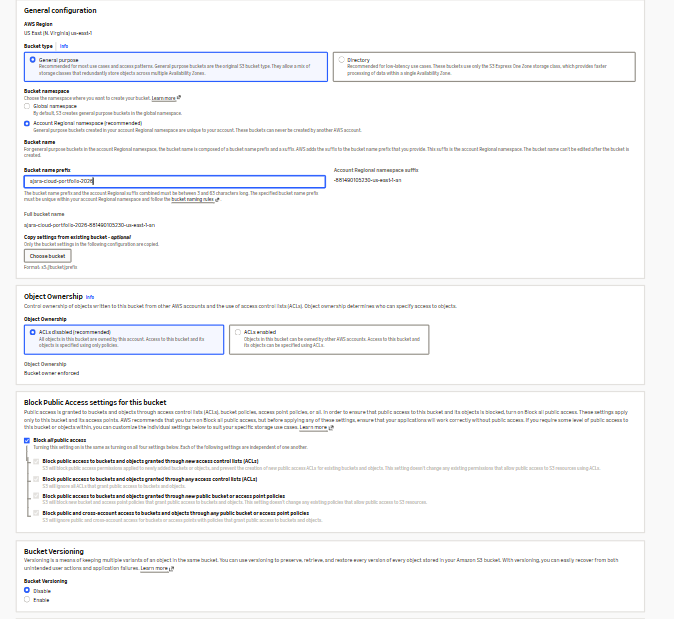
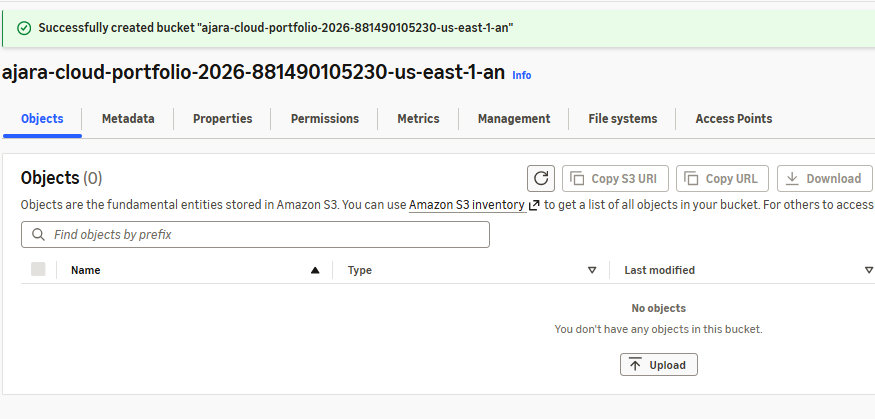
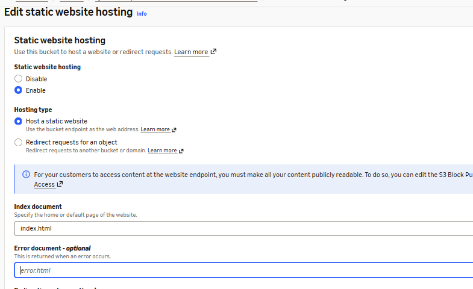
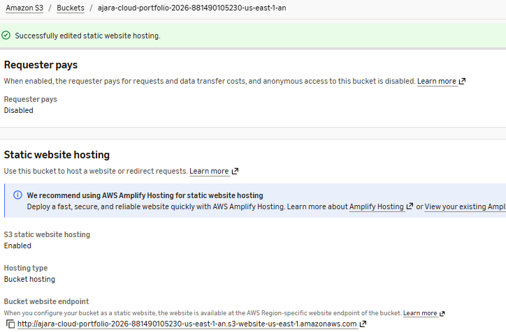
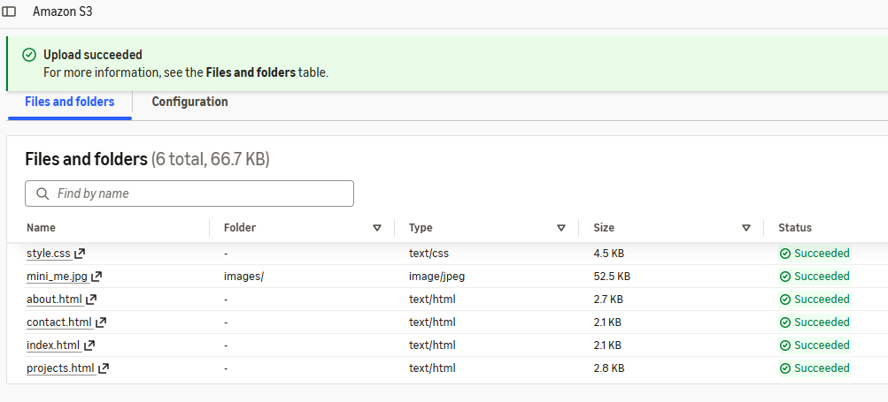
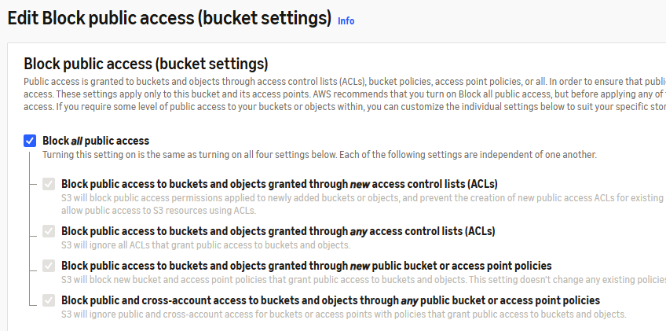
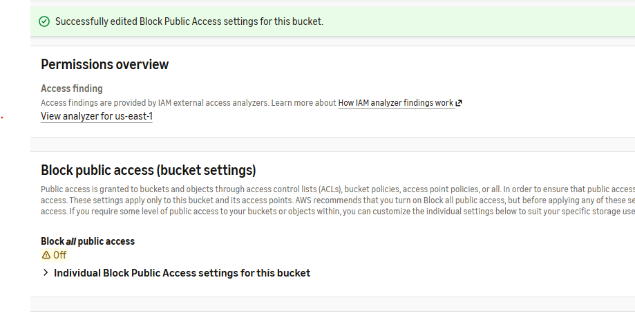
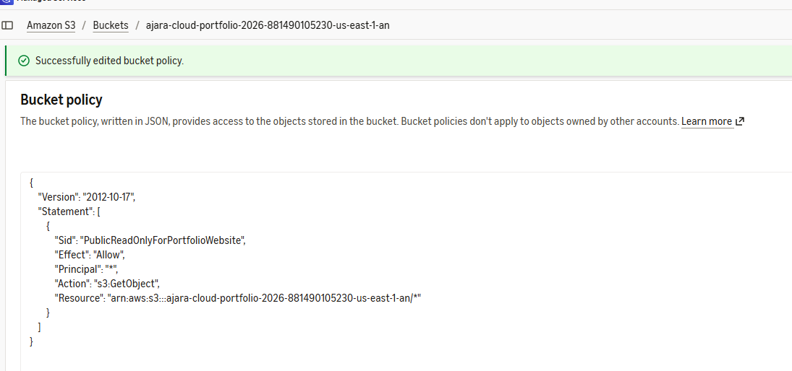
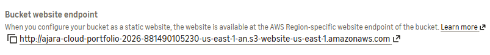
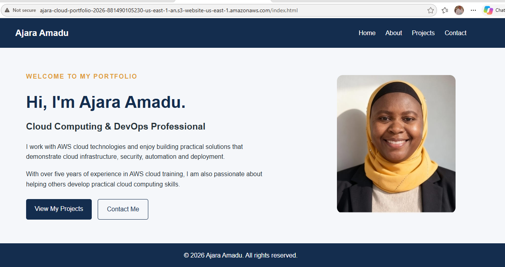

# AWS S3 Static Portfolio Website

## Project Overview

This project demonstrates how to build and deploy a static portfolio website using **Amazon Simple Storage Service (Amazon S3)**.

The website was developed using HTML5 and CSS3 and hosted on Amazon S3 using its static website hosting feature.

The project provided hands-on experience with cloud storage, S3 bucket configuration, object management, static website hosting and access control through bucket policies.

## Live Website

[Visit the Live Portfolio Website](http://ajara-cloud-portfolio-2026-881490105230-us-east-1-an.s3-website-us-east-1.amazonaws.com)

## GitHub Repository

[View the Project Source Code](https://github.com/aj-sys/aws-s3-static-portfolio-website)

---

## Project Objectives

The main objectives of this project were to:

- Understand Amazon S3 buckets and objects.
- Create and configure an Amazon S3 bucket.
- Understand object keys and folder-like prefixes.
- Upload and organise website files and image assets.
- Enable static website hosting.
- Understand S3 Block Public Access settings.
- Configure a bucket policy for public, read-only access.
- Deploy and test a working static website using the S3 website endpoint.

## Technologies and AWS Services

| Technology / Service | Purpose |
|---|---|
| Amazon S3 | Object storage and static website hosting |
| HTML5 | Website structure and content |
| CSS3 | Website styling and responsive layout |
| AWS Management Console | S3 configuration and deployment |
| S3 Bucket Policy | Managing public read access to website objects |
| Visual Studio Code | Website development and editing |
| Git and GitHub | Source code management and version control |

---

## Website Features

The portfolio website contains four main pages:

- **Home:** Introduction and professional profile.
- **About:** Professional background, technical interests and certifications.
- **Projects:** Practical cloud and infrastructure projects.
- **Contact:** Contact information and professional links.

Additional features include:

- Responsive website layout.
- Profile image.
- Navigation links between pages.
- Links to GitHub project repositories.
- A link to the deployed website.

---

## AWS Implementation

### 1. S3 Bucket Creation

Created a general-purpose Amazon S3 bucket in the **US East (N. Virginia) – us-east-1** Region.

The bucket was created using the account regional namespace option.

The following configurations were used:

- Object Ownership: Bucket owner enforced.
- Access Control Lists (ACLs): Disabled.
- Versioning: Disabled.
- Default encryption: Server-Side Encryption with Amazon S3 managed keys (SSE-S3).
- Bucket Key: Enabled by default.
- Storage class: S3 Standard for the uploaded website objects.

### 2. Website File Upload

Uploaded the website files and image assets to the S3 bucket through the AWS Management Console.

The bucket object structure was organised as follows:

```text
aws-s3-static-portfolio-website/
│
├── index.html
├── about.html
├── projects.html
├── contact.html
├── style.css
│
└── images/
    └── mini_me.jpg
```

The HTML files provide the website content, the CSS file controls the styling, and the images folder stores the profile image.

### 3. Static Website Hosting

Enabled static website hosting in the S3 bucket Properties settings.

The configuration was:

- Hosting type: Host a static website.
- Index document: index.html.

This allows visitors to access the portfolio through the S3 static website endpoint.

### 4. Public Access Configuration

Reviewed the four S3 Block Public Access settings.

Because ACLs were disabled through Bucket owner enforced ownership, the two ACL-related protections were retained.

The two bucket-policy-related protections were adjusted at the bucket level to allow the public read-only bucket policy to be applied.

### 5. S3 Bucket Policy

Configured a bucket policy granting public read access to website objects.

The policy uses:

- Effect: Allow
- Principal: *
- Action: s3:GetObject
- Resource: The objects within the portfolio bucket.

This allows visitors to retrieve the website files without granting permissions to upload, modify or delete objects through this policy.

**Security consideration:** Publicly accessible website files can be viewed by anyone. Only intended public website content should be stored in this bucket. Never upload credentials, access keys or private information.

### 6. Website Deployment and Testing

After configuring static website hosting and the bucket policy, opened the S3 website endpoint in a web browser.

The following were verified:

- The homepage loaded successfully.
- The profile image displayed correctly.
- CSS styling was applied.
- Navigation between the Home, About, Projects and Contact pages worked.
- The website was accessible through the S3 website endpoint.

---

## Project Screenshots

The following screenshots document the major stages of the project, from S3 bucket configuration to the successful deployment of the portfolio website.

### 1. S3 Bucket Configuration



### 2. Bucket Created



### 3. Static Website Hosting Configuration



### 4. Static Website Hosting Enabled



### 5. Website Objects Uploaded



### 6. Block Public Access Before Configuration



### 7. Block Public Access After Configuration



### 8. Bucket Policy Before Saving


### 9. Saved Bucket Policy



### 10. S3 Website Endpoint



### 11. Live Portfolio Website



---

## Key Learnings

Through this hands-on project, I gained practical experience with:

- Creating and configuring Amazon S3 buckets.
- Understanding buckets, objects and object keys.
- Organising and uploading static website assets.
- Configuring Amazon S3 static website hosting.
- Understanding Block Public Access settings.
- Applying bucket policies to control access to S3 objects.
- Implementing public read-only access.
- Testing a deployed static website on AWS.

## Limitations and Future Improvements

The Amazon S3 static website endpoint uses HTTP and does not directly support HTTPS.

Possible future improvements include:

- Integrating Amazon CloudFront to provide HTTPS delivery.
- Configuring a custom domain name.
- Automating website deployment using GitHub Actions.
- Exploring infrastructure provisioning using Terraform.
- Improving website performance and accessibility.

## Conclusion

This project provided an opportunity to apply Amazon S3 concepts through a practical cloud deployment.

It strengthened my understanding of object storage, bucket configuration, static website hosting and access control using S3 bucket policies.

The project is part of my continued hands-on learning journey in AWS Cloud and DevOps.

---

## Author

**Ajara Amadu**

- [GitHub Profile](https://github.com/aj-sys)
- [LinkedIn Profile](https://www.linkedin.com/in/ajara-amadu-profile/)

